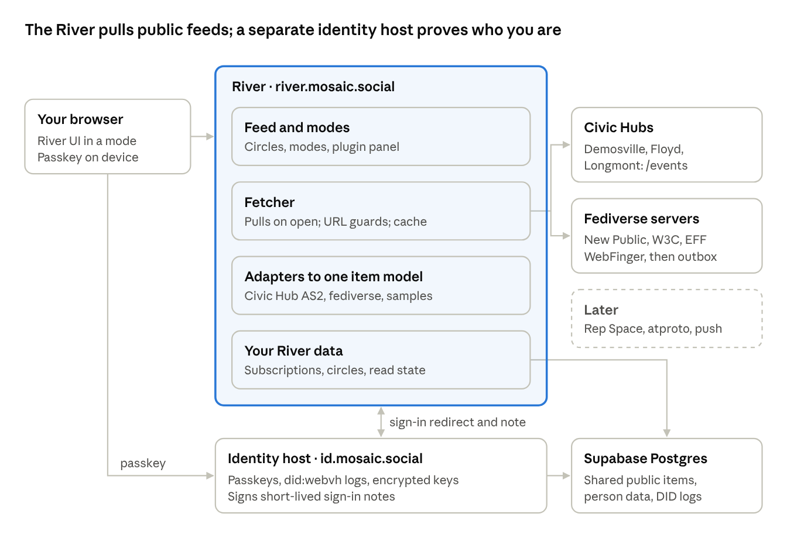

> Background from design Phase 2 (2026-10-19). Some items were changed later: A1's "shared packages" became one codebase with two deployments (ADR-006), and A2's "no scheduled jobs" became one daily pg_cron job (spec 4.5). Where this file and `docs/spec/river-v1.md` differ, the spec wins.

# Mosaic River Architecture: Phase 2 Decisions

2026-10-19 · Adam

These are the architecture decisions for Mosaic River v1, with a recommendation for each, for Adam to approve as one batch. Approved items move into the Decisions Log, and the architecture gets drawn once it settles.

## At a glance

Mosaic River v1 architecture · two apps, one database

The River fetches public feeds from its own server when you open it, turns every source into one item shape, and files your subscriptions and circles under your identity. The identity host is a separate app that holds your passkey-backed DID and vouches for you to the River.

## Recommended decisions

| \#  | Area                                | Recommendation                                                                                                                                                                                                                                                                                                                                                                                                                                                                                           | Main alternative                     | Why                                                                                                                                                                                                               |
|-----|-------------------------------------|----------------------------------------------------------------------------------------------------------------------------------------------------------------------------------------------------------------------------------------------------------------------------------------------------------------------------------------------------------------------------------------------------------------------------------------------------------------------------------------------------------|--------------------------------------|-------------------------------------------------------------------------------------------------------------------------------------------------------------------------------------------------------------------|
| A1  | Two apps, one repo                  | Mosaic-Foundation/river holds two deployable apps: the **River** (river.mosaic.social) and the **identity host** (id.mosaic.social), plus shared packages. Each is an Express API with a React + TypeScript + Vite UI on Node 24, deployed as its own Vercel project.                                                                                                                                                                                                                                    | Identity inside the River app        | Adam wants the identity host replaceable. Two deployables keep the boundary real while one repo keeps the automated build to one Claude Code project.                                                             |
| A2  | Getting updates (v1)                | The River pulls. When a person opens or refreshes, a server function fetches every followed source in parallel (5–8 s timeout each, results gathered so one failure never blocks the rest), using since-cursors, ETags and a 60–180 s shared cache. No scheduled jobs.                                                                                                                                                                                                                                   | Cron polling                         | Vercel Hobby crons run at most daily. Fetch-on-open costs nothing when nobody is reading.                                                                                                                         |
| A3  | ActivityPub in v1                   | No River actor yet. Read Civic Hubs through /events (AS2) and fediverse accounts through WebFinger → actor → outbox, unsigned. Fall back to the Mastodon public API when an outbox read fails. Boosts show as "X boosted a post" with a link; the boosted post is fetched only when opened.                                                                                                                                                                                                              | Build an actor with Fedify now       | Live checks show unsigned outbox reads work on mastodon.social, w3c.social and wikis.world. Fedify's queue wants a long-running worker, which Vercel serverless lacks. The actor comes with the push model later. |
| A4  | One item model                      | Every source becomes one **River item**: id, source, kind (post, article, civic activity, event, sample), author (name, id, link, avatar), published time, title, summary, sanitized content, link back to the source, audience (public or restricted), media, boost-of, a civic block (process type, process id, activity type, place code) and the original JSON kept as-is. Small adapters per source type: Civic Hub AS2, fediverse, sample entries; Representative Space v0.1 and atproto as stubs. | Keep each source's own shape         | One shape lets filters, circles, read state and the dashboard panel work the same for every source. Keeping the original JSON means nothing is lost if the shape grows.                                           |
| A5  | Which hub activities show           | A renderer table maps (activity type, process type) to a card template, and is closed by default: unknown types are hidden, not shown raw. It starts from the dashboard's feedActivity.ts classifier.                                                                                                                                                                                                                                                                                                    | Show everything the hub emits        | Hubs emit internal steps (ballots, aggregations, review steps) that would read as noise.                                                                                                                          |
| A6  | Stored items                        | Public items are stored once per source in Postgres and shared by everyone who follows that source. Restricted items, once they exist, are stored per account and never shared. Items older than 90 days are dropped.                                                                                                                                                                                                                                                                                    | Fetch live every time, store nothing | Storing items makes read state, circles, search and fast page loads possible, and keeps the free database small.                                                                                                  |
| A7  | The person's River data             | Postgres tables keyed on the internal account ID: subscriptions (URL, type, follow or mute, optional process filter), circles and their members, read state, preferences. Shaped like the identity spec's personal data store categories (follows, preferences) so it can move into a real one later.                                                                                                                                                                                                    | Store in the browser                 | Browser storage can't follow a person to another device, and portability needs a clean server-side model.                                                                                                         |
| A8  | Identity host internals             | Passkeys through @simplewebauthn/server 14 (MIT). One did:webvh v1.0 per person, created with didwebvh-ts 2.8.0 and portable: true set in the first entry. The log (did.jsonl) is served from Postgres. Ed25519 keys are made in the app and stored encrypted under one master key kept as a server secret. The SCID (the self-certifying part of the DID) is recorded as the stable identity across moves.                                                                                              | Hosted key service (AWS KMS)         | A hosted key service can't release a private key, so people could never take their keys with them. It also costs about \$1 per key per month.                                                                     |
| A9  | Fetching other people's URLs safely | Its own ADR, extending the hub's outbound-call rule (CLAUDE.md constraint 5): HTTPS only, block private and internal addresses, size and time limits, an honest User-Agent, per-host rate limits that honor Retry-After, and HTML sanitized server-side before storage.                                                                                                                                                                                                                                  | Reuse ADR-006/007                    | Those ADRs allow calls to three fixed services. The River fetches addresses people type in, which is a different and larger risk.                                                                                 |
| A10 | Plugins                             | River plugins join the Civic Hub plugin family: same manifest format, same declare-what-you-need permissions, named surfaces. A new tool/view kind with River surfaces: side panel, mode header, feed-card action. v1 bundles first-party plugins only, plus one or two simple ones (e.g. Upcoming events); the Civic mode's panel uses placeholders until data sources arrive.                                                                                                                          | Build the dashboard panel separately | Keeps the dashboard as configuration plus plugins on the River, not a fork.                                                                                                                                       |
| A11 | Modes and instances                 | Modes, not editions. A mode is a way of using the River: default circles, plugins and their placement, optional layout. v1 ships Everything and Civic; the Citizen Dashboard is the Civic mode. Circles stay global across modes. A civic web address opens the River in Civic mode with the Civic theme. Separately, an instance concept chosen by web address (ADR-004 style) holds branding and defaults as data, so organizational Rivers stay possible; only river.mosaic.social is live.           | A separate dashboard app             | One codebase, one account, one set of circles; the dashboard becomes configuration plus plugins. Shared public item storage keeps each extra person or instance close to free.                                    |
| A12 | The old dashboard                   | Leave citizendashboard.civic.social running until the River-based dashboard edition replaces it in Stage 2. Then point the domain at the new edition and archive the old repo.                                                                                                                                                                                                                                                                                                                           | Retire it now                        | It is the only live dashboard demo today.                                                                                                                                                                         |
| A13 | Seeds                               | Hubs: Demosville, Floyd, Longmont (Athens exists only on the dev site, so it is left out). Fediverse: New Public, W3C, EFF, Internet Archive, Wikipedia, Social Web Foundation. Sample entries for a family, a soccer club, a publisher, a neighborhood association and an issue campaign.                                                                                                                                                                                                               | Include the Representative Space     | It hasn't published since July and still uses the old v0.1 format. It joins with the dashboard edition.                                                                                                           |

## Three choices that need Adam's call

**Answered 2026-10-19:** Q1 option 1 now, with option 2 (atproto-style OAuth) recorded as future work. Q2 yes: one identity across the whole ecosystem, with a person's River data belonging to them in a personal-data-store shape. Q3 yes: random short code.

**Q1. How the River learns who you are (v1).**

1.  *Recommended:* a small redirect. The River sends you to id.mosaic.social, you confirm with your passkey, and the identity host sends you back with a short-lived signed note saying "this is DID X, for the River, just now". The River checks the note against your DID document. It is quick to build and already has the shape of the later "sign in with your decentralized identity".

2.  The full standard now: run the identity host as an OAuth server following the profile Bluesky uses for atproto sign-in (resolve the DID, find its sign-in server, then PAR, PKCE and DPoP). Proven and reusable by any site, but more to build before the feed works.

Either way, the plan is to move to option 2 before any site other than the River relies on it, because a home-made protocol needs its own security review.

**Q2. One account across editions?** Recommended: yes. A person who signs in to the Mosaic River and later the Citizen Dashboard has one account, with the same subscriptions and circles. The alternative is a separate account per edition, which is simpler but means following everything twice.

**Q3. What goes in a person's DID address.** Recommended: a random short code, such as did:webvh:…:id.mosaic.social:u:k7q2m9, not a chosen username. Renaming a username would count as moving the DID. People see a display name, never the DID.

## Security and reliability notes

- **Typed-in URLs are the main risk.** Anyone can make the River fetch an address. Without the A9 guards, that could reach internal services or hang the server.

- **Remote content is untrusted.** Mastodon posts arrive as HTML. Sanitize them before storing, and never render raw HTML from a source.

- **Rate limits are shared.** Mastodon allows about 300 unauthenticated requests per 5 minutes per IP, and every River visitor shares Vercel's outbound addresses. Cache outbox pages for 60–180 s, ask only for posts newer than the last one seen, and serve the last good copy when a server says slow down.

- **Hubs can be slow to wake.** One Demosville request timed out at 20 s, then answered in 0.5 s on retry. Use a timeout plus one retry.

- **Short pages are normal.** A hub page can return fewer items than asked for while still pointing to a next page. Follow next until it is absent.

- **Custodied keys are the crown jewels.** Keep the master key only in server secrets, never in the database or the repo. Log every use of a person's key. Plan the "take my keys" export early, even if its screen comes later.

- **Choose the passkey domain once.** Passkeys are bound to id.mosaic.social. Changing that domain later would strand everyone's passkeys.

- **After a DID moves.** The did:webvh spec doesn't say what the old address should serve. We need our own rule: keep serving the log with a pointer to the new address.

- **Library license check.** didwebvh-ts says Apache-2.0 on npm but MIT in its README. Both are compatible with AGPL, but confirm the LICENSE file before relying on it.

## Spec changes these decisions imply

For a later Civic.Social spec pass. None of them blocks the build.

| Spec                 | Change                                                                                                                                                                                                                                                   |
|----------------------|----------------------------------------------------------------------------------------------------------------------------------------------------------------------------------------------------------------------------------------------------------|
| Identity             | Add an identity-host role (custodial did:webvh with passkey sign-in and a path to self-custody). Name did:webvh as the person-level method. Demote SIOPv2 to optional. Record that wallet login (OpenID4VP) is a later login method, not the front door. |
| Identity             | Define "sign in with your decentralized identity" as an OAuth profile modeled on atproto's, keyed to the DID's service entry.                                                                                                                            |
| Space                | Replace the v0.1 feed format in §7.2.4, §10.3 and §5.1 with Activity v0.2's AS2 collection.                                                                                                                                                              |
| Discovery            | Use Move instead of civic.space.migrated in §7.4.                                                                                                                                                                                                        |
| Plugin architecture  | Add surface names beyond process-card and process-page, starting with river.panel. Specify the tool-plugin kind.                                                                                                                                         |
| Activity             | Note that consumers may read without an actor (Level 1 pull), and that Level 2 push needs a pinned signature profile.                                                                                                                                    |
| Root CLAUDE.md       | Point to civic-social-docs/specs/ as canonical, not the root specs/.                                                                                                                                                                                     |
| Representative Space | Move from the v0.1 envelope to the v0.2 AS2 feed, so the dashboard edition needs no special adapter.                                                                                                                                                     |

## Sources

Checked 2026-10-19, by research agents reading these pages and by live requests to the hubs.

- [did:webvh v1.0 spec](https://identity.foundation/didwebvh/v1.0/) and [editor's draft](https://identity.foundation/didwebvh/next)

- [DIF Recommended DID Methods, June 2026](https://blog.identity.foundation/two-recommended-did-methods/)

- [didwebvh-ts](https://github.com/decentralized-identity/didwebvh-ts) and [Interop Alliance fork](https://github.com/interop-alliance/did-method-webvh)

- [ToIP did:scid draft](https://lf-toip.atlassian.net/wiki/spaces/HOME/pages/88572360)

- [SimpleWebAuthn releases](https://github.com/MasterKale/SimpleWebAuthn/releases) and [passkeys.dev device support](https://passkeys.dev/device-support/)

- [atproto OAuth spec](https://atproto.com/specs/oauth) and [atproto DID spec](https://atproto.com/specs/did)

- [AWS KMS asymmetric keys](https://docs.aws.amazon.com/kms/latest/developerguide/symmetric-asymmetric.html) and [pricing](https://aws.amazon.com/kms/pricing/)

- [Mastodon outbox controller](https://github.com/mastodon/mastodon/blob/main/app/controllers/activitypub/outboxes_controller.rb), [rate limits](https://docs.joinmastodon.org/api/rate-limits/) and [authorized fetch](https://docs.joinmastodon.org/admin/config/)

- [Vercel cron limits](https://vercel.com/docs/cron-jobs/usage-and-pricing)

- Live checks: https://{demosville,floyd,longmont,athens}.civic.social/events and /.well-known/civic.json
